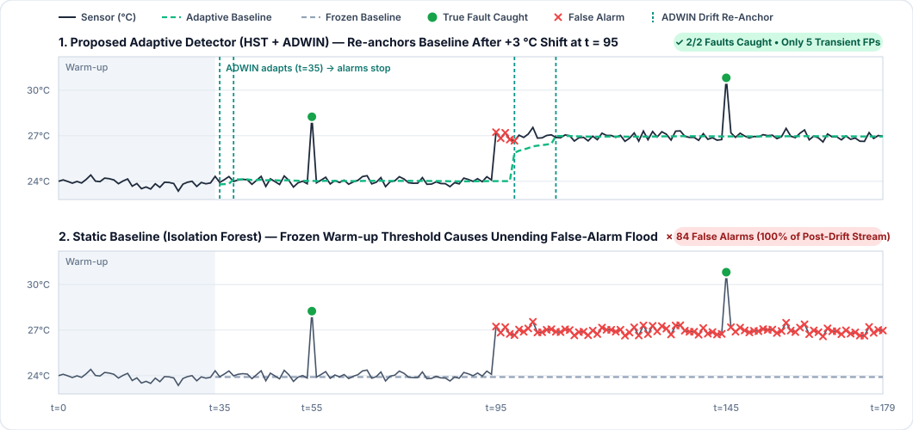
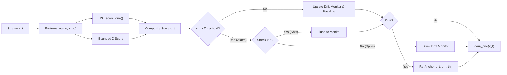
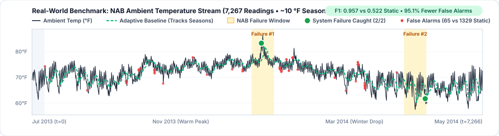

<div align="center">



<br/>

[](requirements.txt)
[%20Time%20%7C%20~96%20KB-059669?style=for-the-badge)](src/detector.py)
[](data/nab/)
[](src/dashboard.py)
[](tests/test_detector.py)

<p align="center">
  <b>Single-pass, zero-label anomaly detection that rides concept drift instead of drowning in false alarms.</b><br/>
</p>

[Problem](#-the-problem) •
[Visual Proof](#-adaptive-vs-static) •
[Architecture](#-architecture) •
[Benchmarks](#-benchmarks) •
[Quick Start](#-quick-start)

</div>

---

## ⚡ The Problem

<table>
  <tr>
    <td width="33%" valign="top">
      <b>🌊 Concept Drift</b><br/>
      Sensor baselines shift with weather, wear, and load—with zero labels or prior distributions.
    </td>
    <td width="33%" valign="top">
      <b>🚨 False-Alarm Floods</b><br/>
      Frozen offline thresholds mistake harmless shifts for faults, firing thousands of false alerts.
    </td>
    <td width="33%" valign="top">
      <b>⏱️ Stream Constraints</b><br/>
      Unbounded data demands single-pass $O(1)$ scoring, sub-ms latency, and fixed RAM.
    </td>
  </tr>
</table>

> [!IMPORTANT]
> **Solution:** Pair vectorized **Half-Space Trees (HST)** with interchangeable **streak-gated drift monitors (`ADWIN`, `Page-Hinkley`, `KSWIN`)** to re-anchor baselines and thresholds live—with **zero offline retraining** and **no Rust/C++ dependencies**.

---

## 🎯 Adaptive vs. Static

A $+3\,^\circ\text{C}$ baseline shift at $t=95$ causes Static Isolation Forest to fire on **every post-drift sample** (`84` false alarms). **HST + ADWIN** confirms the shift in 5 steps, re-anchors, and catches both real faults ($t=55, 145$):

<p align="center">
  
</p>

---

## 🧠 Architecture

Every sample $x_t$ is **scored before learning** (strict prequential *test-then-train*, zero future leakage):



- **Native Half-Space Trees:** Flat NumPy ensemble ($25$ trees, depth $8$) + $O(1)$ circular-buffer window statistics in `~96 KB` RAM; auto-uses `river` if installed.
- **Interchangeable Streak-Gated Drift Monitors (`ADWIN`, `Page-Hinkley`, `KSWIN`):** Blocks 1-step spikes from corrupting the baseline, while flushing sustained shifts ($\ge 5$ steps) to trigger instant adaptation.
- **Cold-Start & Winsorized Variance:** Establishes $(\mu_0, \sigma_0)$ over the initial `N₀` warm-up window and floors $\sigma_t$ during quiet spells to prevent micro-jitter false alarms.

<details>
<summary><b>🔬 Mathematical Formulation (click to expand)</b></summary>

- **Composite Score:** $s_t = w_{\text{hst}} \cdot s_{\text{hst}}(x_t) + (1 - w_{\text{hst}})\big(1 - \exp(-\lambda |x_t - \mu_t| / \sigma_t)\big)$
- **Dynamic Threshold:** $\text{thr}_t = \text{clip}(\mu_s + k \cdot \max(\sigma_s, \sigma_{\text{floor}}),\, \text{thr}_{\min},\, \text{thr}_{\max})$
- **ADWIN Cut Bound:** Splits window $W$ into $W_0, W_1$ when $|\hat{\mu}_0 - \hat{\mu}_1| > \sqrt{2(\tfrac{1}{n_0}+\tfrac{1}{n_1})\hat{\sigma}^2_{\text{pooled}}\ln(\tfrac{2\ln n}{\delta})}$
- **Page-Hinkley & KSWIN:** Two-sided cumulative-sum mean-shift test (`Page-Hinkley`) and two-sample Kolmogorov–Smirnov sliding-window distribution test (`KSWIN`).

</details>

---

## 📊 Benchmarks

### Real-World NAB Streams

Evaluated on official [Numenta Anomaly Benchmark (`realKnownCause`)](https://github.com/numenta/NAB) windows using **Window-Adjusted F1** and normalized **NAB Score** $\in [0, 100]$:

<p align="center">
  
</p>

| Stream & Detector | Caught | False Alarms ↓ | F1 ↑ | NAB Score ↑ | Latency | Memory |
| :--- | :---: | :---: | :---: | :---: | :---: | :---: |
| **NAB Ambient Temp** *(7,267 pts, ~10 °F seasonal drift)* | | | | | | |
| **🟢 HST + ADWIN (Adaptive)** | **2 / 2** | **65** | **0.957** | **65.3** | **0.26 ms** | **96.2 KB** |
| 🟢 HST + KSWIN (Adaptive) | 2 / 2 | 69 | 0.955 | 63.3 | 0.26 ms | 95.7 KB |
| 🟢 HST + Page-Hinkley (Adaptive) | 2 / 2 | 110 | 0.930 | 64.8 | 0.27 ms | 96.4 KB |
| ⚪ Plain HST *(No Drift Adapt)* | 2 / 2 | 293 | 0.832 | 76.2 | 0.11 ms | 93.4 KB |
| 🔴 Static Isolation Forest | 2 / 2 | 1,329 | 0.522 | 24.3 | 4.53 ms | 707.2 KB |
| 🔴 Static One-Class SVM | 2 / 2 | 2,290 | 0.388 | 0.0 | 0.27 ms | 4.0 KB |
| **NAB Machine Temp** *(22,695 pts)* | | | | | | |
| **🟢 HST + Page-Hinkley (Adaptive)** | **4 / 4** | **509** | **0.899** | **69.9** | **0.12 ms** | **95.9 KB** |
| 🟢 HST + KSWIN (Adaptive) | 4 / 4 | 544 | 0.893 | 65.3 | 0.12 ms | 95.5 KB |
| **🟢 HST + ADWIN (Adaptive)** | **4 / 4** | **579** | **0.887** | **63.9** | **0.15 ms** | **96.1 KB** |
| ⚪ Plain HST *(No Drift Adapt)* | 4 / 4 | 1,717 | 0.725 | 49.9 | 0.10 ms | 93.4 KB |
| 🔴 Static Isolation Forest | 4 / 4 | 5,205 | 0.466 | 0.0 | 5.64 ms | 745.5 KB |
| 🔴 Static One-Class SVM | 4 / 4 | 8,785 | 0.341 | 0.0 | 0.26 ms | 4.1 KB |
| **NAB CPU Utilization** *(18,050 pts)* | | | | | | |
| **🟢 HST + Page-Hinkley (Adaptive)** | **1 / 1** | **1,168** | **0.720** | **67.5** | **0.18 ms** | **97.4 KB** |
| 🟢 HST + ADWIN / KSWIN (Adaptive) | 1 / 1 | 1,221 | 0.711 | 66.2 | 0.17–0.33 ms | ~97 KB |
| ⚪ Plain HST *(No Drift Adapt)* | 1 / 1 | 1,243 | 0.707 | 65.3 | 0.24 ms | 93.4 KB |
| 🔴 Static One-Class SVM | 1 / 1 | 1,422 | 0.678 | 61.9 | 0.11 ms | 3.9 KB |
| 🔴 Static Isolation Forest | 1 / 1 | 1,725 | 0.635 | 58.1 | 1.99 ms | 455.0 KB |

### Controlled Drift Stress-Tests *(N = 180, all real faults caught)*

| Scenario | **HST + ADWIN** FPs | Plain HST FPs | Static iForest FPs | Static OCSVM FPs |
| :--- | :---: | :---: | :---: | :---: |
| **Gradual Ramp** (`+3.2 °C` + 2 faults) | **0** 🏆 | 56 | 85 | 92 |
| **Sudden Step** (`+3.0 °C` + 2 faults) | **5** 🏆 | 81 | 84 | 84 |
| **Recurring Shift** (high load & back) | **10** 🏆 | 58 | 59 | 59 |
| **Clean Stationary** (0 faults) | **0** 🏆 | 0 | 0 | 1 |

---

## 🚀 Quick Start

```bash
# 1. Install dependencies (native HST + ADWIN / Page-Hinkley / KSWIN — no Rust compiler required)
python -m pip install -r requirements.txt

# 2. Launch interactive Streamlit studio (replay, ablation & drift-injection UI)
streamlit run src/dashboard.py

# 3. Reproduce CLI benchmark table across all 3 NAB streams & 6 models
python scripts/run_benchmark.py

# 4. Run automated verification suite
python -m pytest tests/test_detector.py -v
```

### Python Streaming API
```python
from src.detector import OnlineAnomalySystem

detector = OnlineAnomalySystem(
    warmup=50,
    k_sigma=3.0,
    adwin_delta=0.002,
    drift_method="adwin",  # "adwin" | "page_hinkley" | "kswin"
)

for reading in sensor_stream:
    res = detector.step({"value": reading})
    if res["alarm"]:
        print(f"🚨 Fault! score={res['score']:.3f} > thr={res['threshold']:.3f}")
```

---

## 🗂️ Project Structure

```text
Anomaly-Detection-With-Concept-Drift-Handling/
├── assets/                    # Animated SVG hero banner & benchmark plots
├── config.toml                # Hot-reloadable hyperparameters (HST, drift monitors, thresholds)
├── data/
│   ├── normal.csv, anomaly.csv # 60-sample synthetic clean & spike test fixtures
│   ├── nab_raw/               # Raw NAB files + official combined_windows.json labels
│   └── nab/                   # Processed NAB streams (timestamp, value, label)
├── scripts/
│   ├── prepare_nab.py         # Converts nab_raw/ -> nab/ using official NAB anomaly windows
│   └── run_benchmark.py       # Reproducible CLI benchmark across 3 NAB streams & 6 models
├── src/
│   ├── config.py              # TOML configuration loader & override helper
│   ├── detector.py            # HST + (ADWIN / Page-Hinkley / KSWIN), Static baselines, NAB scorer
│   └── dashboard.py           # Interactive Streamlit replay, ablation & sensitivity studio
└── tests/
    └── test_detector.py       # Automated verification suite (normal, spike, drift & benchmark tests)
```

<details>
<summary><b>📚 References &amp; Dataset Licence</b></summary>

- **HST:** Tan, Ting & Liu (2011), *Fast anomaly detection for streaming data*, IJCAI.
- **ADWIN:** Bifet & Gavaldà (2007), *Learning from time-changing data with adaptive windowing*, SIAM SDM.
- **Page-Hinkley & KSWIN:** Page (1954), *Continuous inspection schemes*, Biometrika; Raab, Heusinger & Schleif (2020), *Reactive soft prototype computing for concept drift streams*, Neurocomputing.
- **NAB:** Ahmad et al. (2017), *Unsupervised real-time anomaly detection for streaming data*, Neurocomputing ([Numenta/NAB](https://github.com/numenta/NAB), AGPL-3.0 — regenerate via `python scripts/prepare_nab.py`).
- **Benchmark & Drift:** Cao et al. (2025), *AI Review*; Gama et al. (2014), *ACM Computing Surveys*.

</details>

---

<div align="center">

**AIML Lab (`IS353IA`) — Experiential Learning** • **RV College of Engineering®, Dept. of CSE**  
**Team:** Mohith S D Gowda (`1RV24CS158`) · Navaneeth V (`1RV24CS165`) &nbsp;|&nbsp; **Guide:** Dr. Veena Gadad

</div>
